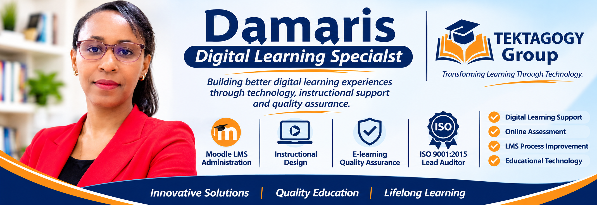

---

# Damaris | Digital Learning Specialist

Welcome to my professional portfolio.

I am a Digital Learning Specialist with experience in Moodle LMS administration, lecturer support, instructional design, online assessment management and digital learning quality assurance.

My work focuses on helping educational institutions strengthen their digital learning environments and improve the effective use of technology in teaching and learning.

## Professional Expertise

- Moodle LMS administration and support
- Lecturer training and capacity building
- Online assessment and quiz management
- Instructional design and course development
- Digital learning quality assurance
- ISO 9001:2015 internal auditing
- LMS process improvement

## Featured Projects

### 1. Moodle LMS Administration Toolkit

A collection of practical resources for Moodle administrators, lecturers and digital learning support teams.

- [Explore the Moodle Toolkit](https://github.com/tektagogygroup-ui/moodle-lms-administration-toolkit)
- [View Moodle Assessment Administration Demonstration](https://github.com/tektagogygroup-ui/moodle-lms-administration-toolkit/blob/main/moodle-assessment-administration-demo.md)
- [View Moodle LMS Administration Project](moodle-lms-administration-project.md)
### 2. Professional Experience Case Study

A practical overview of my professional experience in Moodle LMS administration, lecturer support, online assessment and ISO 9001:2015-informed institutional quality assurance.

- [Read My Professional Experience Case Study](professional-experience-case-study.md)

### 3. TEKTAGOGY Group

Digital learning and educational technology initiatives.

- [Visit TEKTAGOGY Group](https://tektagogygroup-ui.github.io/)

## Professional Interests

I am interested in opportunities involving:

- Remote digital learning support
- Moodle administration
- Learning management system implementation
- Instructional design
- E-learning quality assurance
- Educational technology consultancy

## Connect

I welcome opportunities for professional collaboration, remote digital learning roles and educational technology consultancy.

- **LinkedIn:** [Connect with Damaris](https://www.linkedin.com/in/damaris-mwithiga-1455b825)
- **GitHub:** [TEKTAGOGY Group](https://github.com/tektagogygroup-ui)
- **Website:** [TEKTAGOGY Group](https://tektagogygroup-ui.github.io/)

---

*Building better digital learning experiences through technology, instructional support and quality assurance.*
