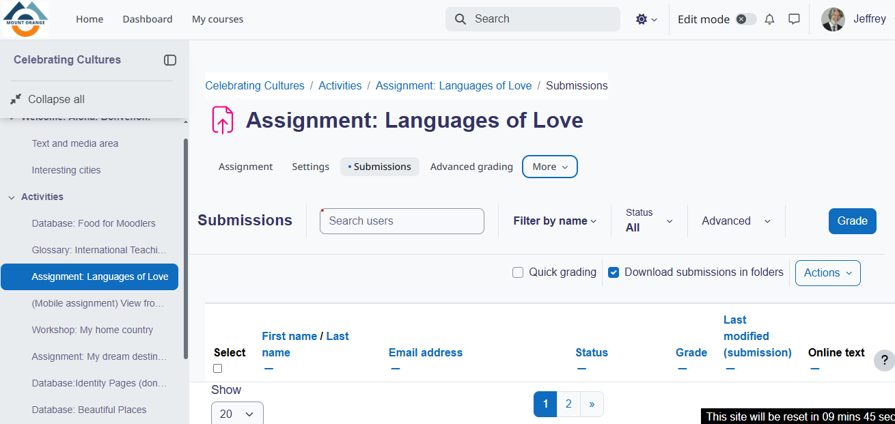
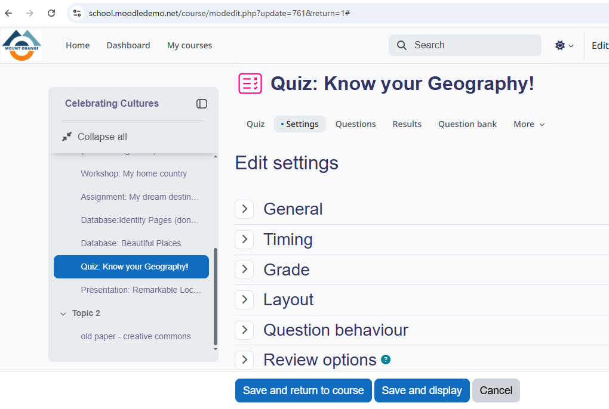
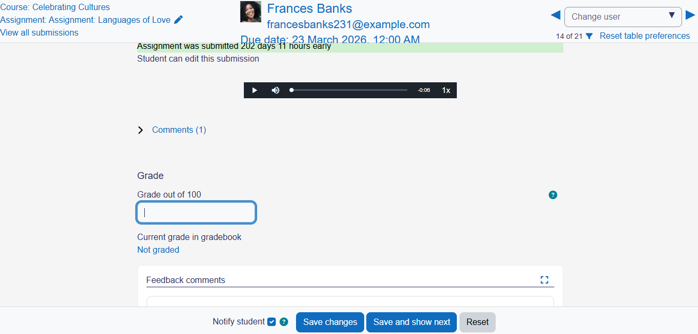

# Moodle LMS Administration & Digital Learning Support Project

**Portfolio Project | Damaris – Digital Learning Specialist | TEKTAGOGY Group**

## 1. Project Overview

This project demonstrates professional competencies in Moodle Learning Management System (LMS) administration, lecturer support, online assessment management and digital learning quality assurance.

It brings together practical workflows, administrative processes and demonstration activities relevant to the effective management of institutional Moodle environments.

The project is intended to demonstrate how structured LMS administration and lecturer support contribute to effective digital teaching and learning.

## 2. Professional Focus Areas

### 2.1 Moodle LMS Administration

- Moodle course administration and configuration.
- Course readiness and quality checks.
- User access and enrolment support.
- LMS troubleshooting and technical support.
- Supporting effective use of Moodle activities and resources.

### 2.2 Online Assessment Management

- Assignment activity configuration.
- Quiz settings and administration.
- Assessment timing and grading configuration.
- Submission monitoring and management.
- Grade entry and feedback support.
- Troubleshooting common quiz and assessment issues.

### 2.3 Lecturer Support and Capacity Building

- Supporting lecturers in using Moodle.
- Guiding lecturers in setting up online courses.
- Supporting online assignment and quiz creation.
- Assisting with assessment configuration and grading.
- Promoting effective use of digital teaching tools.

### 2.4 Digital Learning Quality Assurance

- LMS course readiness reviews.
- Assessment configuration checks.
- Documentation of support processes.
- Identification of configuration and usability issues.
- Continual improvement of digital learning processes.

## 3. Practical Demonstration Activities

The following activities provide practical examples of Moodle administration knowledge and workflows.

| Demonstration | Focus |
|---|---|
| Moodle course setup | Course configuration and readiness |
| Quiz troubleshooting | Assessment attempts and configuration |
| Assignment administration | Submissions, grading and feedback |
| Quiz administration | Timing, grading, question behaviour and review options |
| Lecturer onboarding | Lecturer guidance and support |
| LMS quality audit | Quality checks and process improvement |

For a detailed assessment administration demonstration, see:

[Moodle Assessment Administration: Practical Demonstration](https://github.com/tektagogygroup-ui/moodle-lms-administration-toolkit/blob/main/moodle-assessment-administration-demo.md)

For additional practical resources, visit the [Moodle LMS Administration Toolkit](https://github.com/tektagogygroup-ui/moodle-lms-administration-toolkit).

## 4. Administrative Workflow

A structured Moodle support workflow can be organised as follows:

1. Receive and document an LMS support request.
2. Identify the course, activity or user-access issue.
3. Investigate the relevant Moodle configuration.
4. Identify the likely cause of the problem.
5. Apply or recommend an appropriate resolution.
6. Test the outcome where appropriate.
7. Communicate the resolution to the lecturer or affected user.
8. Document recurring issues and improvement opportunities.

## 5. Professional Competencies

This project demonstrates knowledge and capabilities in:

- Moodle LMS administration.
- Online course administration.
- Lecturer technical support.
- Online assessment management.
- Quiz and assignment troubleshooting.
- Digital learning implementation.
- LMS quality assurance.
- Process documentation and improvement.

## 6. Quality Assurance Approach

Quality assurance is an important component of effective LMS administration.

The project incorporates an ISO 9001:2015-informed approach through:

- Documented administrative procedures.
- Consistent LMS readiness checks.
- Identification and resolution of system-related issues.
- Monitoring of support processes.
- Continual improvement.

The resources are professional demonstrations and are not represented as official ISO certification documents or institutional audit findings.

## 7. Evidence and Project Scope

This portfolio project combines professional experience with practical demonstrations of Moodle functionality.

The assessment administration demonstration was explored using the publicly accessible Mount Orange Moodle demonstration environment.

The demonstration does not claim that changes were made to a live institutional Moodle installation.

No confidential institutional information, identifiable learner records or private system credentials are included.

## 8. Professional Relevance

The project illustrates practical knowledge of the processes involved in supporting Moodle-based digital learning environments.

It is relevant to opportunities in:

- Remote Moodle LMS administration.
- Digital learning support.
- E-learning coordination.
- Learning management system implementation.
- Lecturer training and capacity building.
- Instructional design support.
- Digital learning quality assurance.

## 9. Professional Portfolio

**Professional:** Damaris – Digital Learning Specialist

**Organisation:** TEKTAGOGY Group

- [LinkedIn Professional Profile](https://www.linkedin.com/in/damaris-mwithiga-1455b825)
- [GitHub Professional Portfolio](https://github.com/tektagogygroup-ui/damaris-digital-learning-portfolio)
- [TEKTAGOGY Group Website](https://tektagogygroup-ui.github.io/)

---
## 10. Practical Moodle Interface Evidence

The following screenshots illustrate selected Moodle assessment administration workflows explored in the public Mount Orange demonstration environment.

### 10.1 Assignment Submission Management

This screenshot illustrates the lecturer's assignment submission management interface, including submission monitoring and available grading actions.

### 10.2 Quiz Configuration

This screenshot demonstrates Moodle quiz configuration, including assessment settings and administration options.

### 10.3 Grading and Feedback

This screenshot illustrates the Moodle grading interface and the provision of feedback to learners.

## 11. Moodle LMS Administration Skills Matrix

The following matrix summarises key Moodle administration and digital learning support competencies, together with examples of supporting portfolio evidence.

| Competency Area | Skills and Activities | Supporting Evidence |
|---|---|---|
| Moodle Course Administration | Course setup, configuration, readiness checks and organisation of learning resources | Moodle Course Setup Checklist |
| User and Lecturer Support | Lecturer onboarding, guidance and troubleshooting support | Lecturer Moodle Onboarding Guide |
| Assignment Administration | Submission monitoring, grading workflows and feedback management | Assignment Administration Demonstration and screenshots |
| Quiz Administration | Quiz timing, grading, attempts, question behaviour and review settings | Quiz Configuration Demonstration and screenshot |
| Assessment Troubleshooting | Investigating quiz access, attempt and configuration issues | Moodle Quiz Troubleshooting Guide |
| LMS Quality Assurance | Course readiness reviews, process checks and continual improvement | ISO 9001-Informed LMS Quality Audit Checklist |
| Digital Learning Support | Supporting effective use of Moodle activities and resources in teaching and learning | Professional Experience Case Study |

### 11.1 Professional Application

These competencies support the effective administration of Moodle-based learning environments and the delivery of responsive technical and instructional support to lecturers and learners.

The evidence links provide examples of practical resources and demonstrations. They should be considered alongside my professional experience and not as a claim that every listed activity was performed in the public demonstration environment.

### 11.2 Relevant Professional Opportunities

The competencies are applicable to roles such as:

- Moodle LMS Administrator
- Digital Learning Specialist
- E-learning Support Officer
- Learning Management System Coordinator
- Online Learning Support Specialist
- Educational Technology Consultant
- LMS Quality Assurance Officer

*All screenshots are from the public Mount Orange Moodle demonstration environment and are included for professional demonstration purposes.*
*Building better digital learning experiences through effective LMS administration, lecturer support and quality assurance.*
